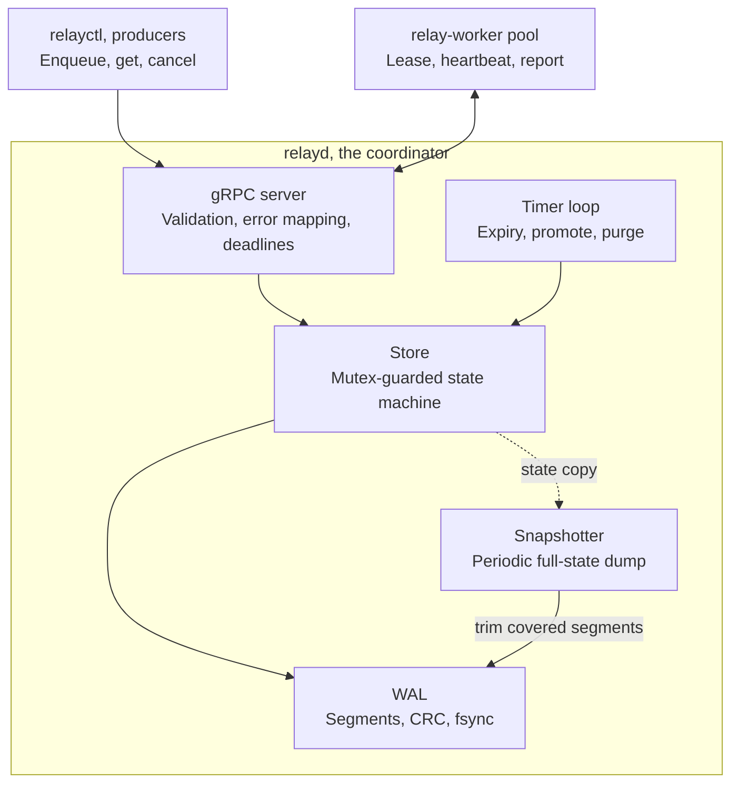
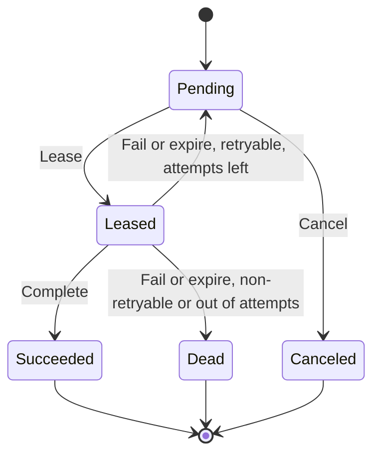

# Relay

A durable, at-least-once job queue in Go. A coordinator (`relayd`) keeps all state, workers lease jobs from it, and a CLI (`relayctl`) submits and inspects them. A job is not lost when a worker dies, the coordinator crashes, or the network drops.

> **Status:** early development. The design is complete and the project is built milestone by milestone (see [Roadmap](#roadmap)). Sections marked *planned* describe behavior that lands in a later milestone.

## Why this project exists

Relay is a learning project for Go backend and systems skills. It is small enough to finish and covers most of what makes the area hard:

- **Concurrency:** many goroutines contend on shared state, with long-polling, timers, heaps and `context` cancellation everywhere.
- **Partial failure:** worker crashes, slow workers, and stale workers finishing late. Leases and fencing tokens are real distributed-systems ideas.
- **Storage internals:** a custom write-ahead log (CRC, torn-write recovery, rotation) and snapshots instead of a database.
- **Network contracts:** gRPC and protobuf with deliberate error semantics.
- **Testing under failure:** `-race`, injected crashes, and a chaos harness that checks invariants.

Consensus is deliberately out of the core. A single coordinator is a known trade-off, and replicating it with Raft is an optional stretch milestone.

## Features

- **Enqueue** jobs with a queue name, type, payload, priority, optional delay, max attempts and an optional idempotency key. The call returns only after the job is durable.
- **Lease** the next job from one or more queues, with long-polling (`wait_ms`). A leased job belongs to exactly one worker for a limited time.
- **Heartbeat** to extend a lease. If the lease is lost, the worker is told and cancels its handler.
- **Complete or fail** a job. Retryable failures requeue with exponential backoff and jitter. When attempts run out, or the failure is non-retryable, the job goes to `Dead`.
- **Lease expiry:** if a worker goes silent, its job is requeued, or marked `Dead` if it is out of attempts.
- **Cancel** a pending job, **get** a job by ID, and read **stats** per queue.
- **Idempotent enqueue:** the same idempotency key returns the existing job instead of creating a duplicate.
- **Crash recovery:** after `kill -9` of the coordinator, a restart restores all jobs and leases from disk.

## Guarantees

| Property | What Relay promises |
|---|---|
| Delivery | **At-least-once.** A job may run more than once, so handlers must be idempotent. Relay does not claim exactly-once. |
| Fencing | A stale worker, one whose lease expired and whose job was re-leased, can never complete or fail the job. It gets `ABORTED`. |
| Durability | An acknowledged enqueue, complete or fail survives a coordinator crash (fsync before ack). |
| Concurrency safety | `go test -race ./...` is clean and `goleak` finds no goroutine leaks. |
| Shutdown | On SIGINT or SIGTERM the coordinator stops accepting work and flushes the WAL. Workers stop leasing and drain in-flight jobs with a timeout. |
| Backpressure | Per-queue pending cap (`RESOURCE_EXHAUSTED`), 1 MiB max payload, bounded worker concurrency. |
| Observability | Structured logs (`log/slog`), plus `/healthz` and `/metrics` endpoints. |

## How it works

Producers and workers both talk gRPC to `relayd`. Every request goes through one mutex-guarded `Store`, which logs to the write-ahead log (WAL) before it changes memory. A snapshotter periodically copies the state out and, once a snapshot is safely on disk, tells the WAL to drop the segments it covers.



Every mutating operation follows the same write path: **validate, append to the WAL (fsync first), apply to memory, then wake waiters and acknowledge.** If a crash happens before the append, the client never got an ack and can retry safely. If it happens after, replay restores the job. Either way, anything acknowledged is durable.

### Job lifecycle

These are the only legal transitions. `Succeeded`, `Dead` and `Canceled` are terminal.



### Leases and fencing

A lease is a time-limited claim on a job. Each lease increments the job's `attempt` counter, and that counter is the fencing token: `Heartbeat`, `Complete` and `Fail` must carry the attempt they were leased with. If a worker stalls and its lease expires, the job is requeued and leased again with a higher attempt. When the first worker finally reports back, its attempt is stale and it gets `ABORTED`. Nothing it does can overwrite the new worker's result. Workers treat `ABORTED` as "I lost the job, stop and move on", never as something to retry.

### Design decisions

- **One mutex around the Store.** Simple and obviously correct. Group commit is a later optimization.
- **Log first, then apply, then ack.** Anything acknowledged is replayable.
- **The log records decisions, not inputs.** For example, the computed `available_at` after backoff is logged, so replay is deterministic, with no re-rolled jitter and no clock dependence.
- **The fencing token is the job's `attempt` counter.** Monotonic per job and free to implement.
- **Cancel only from `Pending`,** which avoids cancelling running work.
- **A `Clock` interface is injected everywhere,** so tests are fast and deterministic with a fake clock.

## Components

| Binary | Role |
|---|---|
| `relayd` | The coordinator: gRPC server, Store, timer loop, WAL and snapshotter. |
| `relay-worker` | A worker pool with a handler registry and the demo handlers `echo`, `sleep`, `flaky` and `crash`. |
| `relayctl` | The CLI, with subcommands `submit`, `get`, `cancel` and `stats`. |

## Usage *(planned, from milestone M3)*

Run the coordinator, start one or more workers, then submit and inspect jobs with `relayctl`:

```
relayd                      # start the coordinator
relay-worker                # start a worker pool
relayctl submit ...         # enqueue a job
relayctl get <job-id>       # show one job
relayctl cancel <job-id>    # cancel a pending job
relayctl stats [queue]      # per-queue counts (all queues if omitted)
```

Exact flags are settled when the commands are built in M3.

## Defaults

| Setting | Value |
|---|---|
| Lease duration | 30s |
| Max attempts | 5 |
| Pending cap | 100k per queue |
| Payload cap | 1 MiB |
| Finished-job retention | 1h |
| Snapshot interval | every 50k events |
| fsync policy | `always` |
| Backoff | base 1s, cap 5m, full jitter |

## Repository layout

```
relay/
  api/relay/v1/relay.proto
  cmd/relayd/        main.go            (flags, wiring, signals)
  cmd/relay-worker/  main.go
  cmd/relayctl/      main.go
  internal/clock/    clock.go           (Clock iface, real + fake)
  internal/job/      job.go             (types, states, transitions)
  internal/backoff/  backoff.go
  internal/store/    store.go queues.go apply.go timers.go
  internal/wal/      wal.go segment.go record.go
  internal/snapshot/ snapshot.go
  internal/server/   producer.go worker.go errors.go
  internal/worker/   runner.go registry.go handlers.go
  test/              e2e_test.go chaos_test.go
  Makefile           (proto, test, race, lint)
```

## Development

**Prerequisites**

- Go 1.27 or newer.
- `buf`, or `protoc` with the `protoc-gen-go` and `protoc-gen-go-grpc` plugins, to generate the gRPC code.
- On Linux and Windows, a C compiler (such as gcc) so the race detector works. macOS does not need one.

**Make targets**

```
make proto   # regenerate the protobuf and gRPC code
make test    # go test ./...
make race    # go test -race ./...
make lint    # static checks
```

`make race` is the main check and must stay green. CI runs `go vet` and `go test -race` on every push.

**Testing approach**

- Table-driven tests for every legal and illegal job transition.
- Fake-clock tests for leases, retries and fencing, so no test sleeps.
- WAL round-trip, corruption and failure-injection tests, and crash-injection tests for snapshots.
- A chaos harness that starts `relayd` and several workers as subprocesses, enqueues 10k jobs with the `flaky` handler, randomly `kill -9`s workers and the coordinator, restarts them, and checks that:
  1. every job reaches `Succeeded` or `Dead`, and none are lost,
  2. no job has a `Succeeded` completion from a stale attempt,
  3. no duplicate jobs exist for a repeated idempotency key,
  4. the run is clean under `-race`.

## Roadmap

The milestones build on each other in a single chain, with one optional stretch goal at the end.

- [ ] **M0. Skeleton:** repo layout, Makefile, compiling proto, `Clock` interface (real and fake), CI.
- [ ] **M1. Domain model and state machine:** the `job` package and `backoff`.
- [ ] **M2. In-memory Store:** enqueue, lease, complete, fail, cancel, stats, heaps, idempotency, backpressure.
- [ ] **M3. gRPC surface, CLI and minimal worker:** servers, error mapping, `relayctl`, long-polling.
- [ ] **M4. Leases, retries and fencing:** lease expiry, timer loop, heartbeats, backoff requeue, `Dead` state.
- [ ] **M5. WAL and recovery:** record format, segments, torn-tail truncation, log-then-apply.
- [ ] **M6. Snapshots and compaction:** safe snapshot writes, WAL truncation, trigger policy.
- [ ] **M7. Hardening and chaos:** graceful shutdown, structured logs, `/healthz`, `/metrics`, retention purge, chaos harness.
- [ ] **M8. Stretch (pick at most one):** WAL group commit, a Raft-replicated coordinator, or sharding by queue name.

## Non-goals

No multi-node coordinator in the core, no auth or TLS, no cron scheduling, no web UI, no job DAGs, and no exactly-once delivery.
